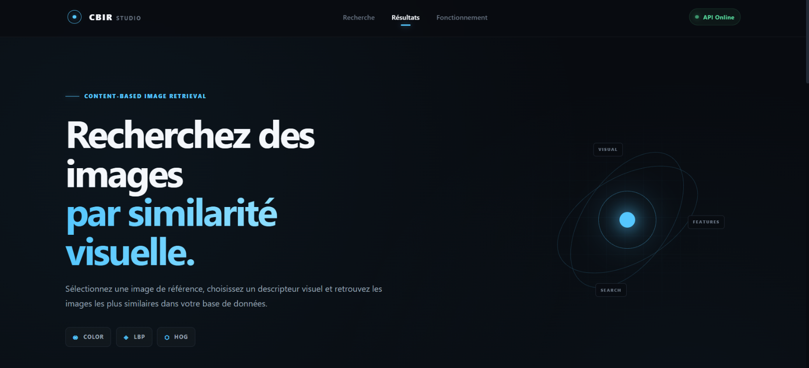
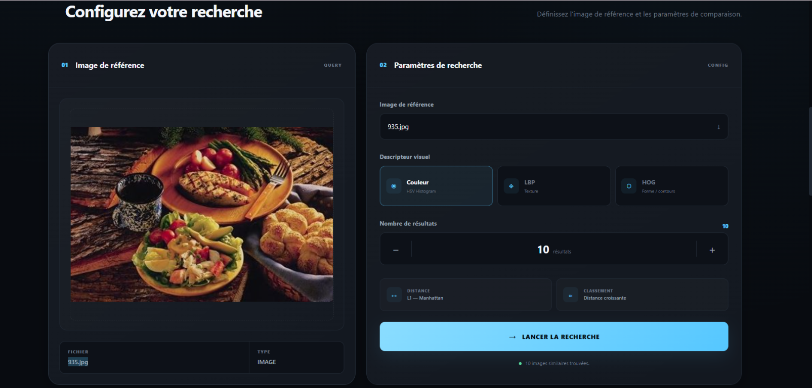
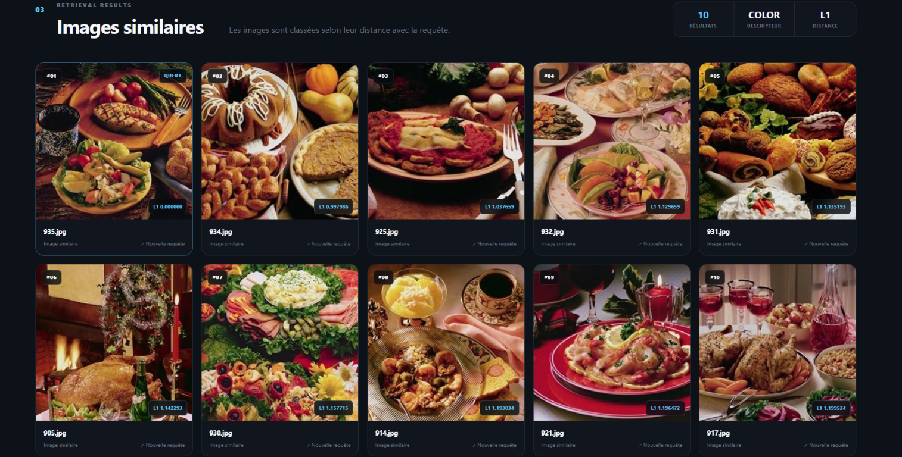

# CBIR Studio

**CBIR Studio** est une application de recherche d’images par le contenu (*Content-Based Image Retrieval*). À partir d’une image de référence présente dans la collection, l’application calcule une signature visuelle, la compare aux signatures pré-calculées et affiche les images les plus proches.

> Projet pédagogique autour de l’indexation et de la recherche d’images par descripteurs visuels. L’application ne s’appuie pas sur des mots-clés ni sur une reconnaissance sémantique des objets.

## Aperçu

### 1. Accueil

<p align="center">
  
</p>

### 2. Configuration d’une recherche

<p align="center">
  
</p>

### 3. Résultats similaires

<p align="center">
  
</p>

## Fonctionnalités

- Interface web en français, servie par l’API FastAPI.
- Sélection d’une image de référence parmi les images disponibles dans `data/test`.
- Recherche avec trois descripteurs : histogramme de couleur HSV, LBP et HOG.
- Classement par distance L1 (Manhattan), de la plus petite à la plus grande.
- Choix du nombre de résultats : de 1 à 50 via l’API (10 par défaut).
- Résultats accompagnés du nom de fichier et de la distance calculée.
- API documentée automatiquement par FastAPI.

## Descripteurs utilisés

| Descripteur | Information visuelle | Implémentation |
|---|---|---|
| **Couleur (HSV)** | Distribution des couleurs dans l’image. | Histogramme 3D HSV, 16 bins par canal par défaut (4 096 valeurs). |
| **LBP** | Motifs locaux et texture en niveaux de gris. | Histogramme de 256 valeurs basé sur les voisinages locaux. |
| **HOG** | Formes et contours représentés par les gradients. | 9 orientations, cellules de 8 × 8 pixels et blocs de 2 × 2 cellules par défaut. |

Chaque descripteur de l’image requête est comparé aux fichiers `.npy` de son index correspondant. La distance L1 est ensuite calculée et les résultats sont triés par ordre croissant : **plus la distance est faible, plus les signatures sont proches**.

## Prérequis

- Python 3.11 recommandé.
- `pip` et un environnement virtuel Python.
- Les images de la collection à rechercher dans `data/test`.

Les dépendances du projet sont listées dans [`requirements.txt`](requirements.txt). Le module HOG importe également `scikit-image` ; installez-le si votre environnement ne le possède pas déjà :

```bash
python -m pip install scikit-image
```

## Installation et démarrage

Depuis la racine du projet, créez et activez un environnement virtuel.

### Windows (PowerShell)

```powershell
py -3.11 -m venv .venv
.\.venv\Scripts\Activate.ps1
python -m pip install --upgrade pip
python -m pip install -r requirements.txt
python -m pip install scikit-image
```

### Linux / macOS

```bash
python3.11 -m venv .venv
source .venv/bin/activate
python -m pip install --upgrade pip
python -m pip install -r requirements.txt
python -m pip install scikit-image
```

Démarrez ensuite l’application depuis la racine du projet :

```bash
uvicorn app.api.main:app --reload
```

- Interface : <http://127.0.0.1:8000>
- Documentation interactive de l’API : <http://127.0.0.1:8000/docs>

L’option `--reload` est pratique en développement. Pour un lancement sans rechargement automatique, retirez-la.

## Indexer les images

Les scripts suivants extraient un descripteur par image de `data/test` et l’enregistrent dans le sous-dossier correspondant de `data/features`. Exécutez-les depuis la racine du projet :

```bash
python scripts/extract_color_features.py
python scripts/extract_lbp_features.py
python scripts/extract_hog_features.py
```

Les index sont enregistrés ici :

```text
data/
├── test/                 # Collection d’images et images accessibles à la recherche
└── features/
    ├── color/            # Descripteurs HSV (.npy)
    ├── lbp/              # Descripteurs LBP (.npy)
    └── hog/              # Descripteurs HOG (.npy)
```

Les noms de base des fichiers image et de leurs descripteurs doivent correspondre. Après l’ajout d’images à `data/test`, relancez les trois scripts pour que chaque méthode de recherche dispose de son index à jour.

## Utiliser l’API

La liste des images disponibles est accessible à l’adresse `GET /api/images`. Pour lancer une recherche, utilisez l’un des endpoints suivants :

| Endpoint | Descripteur |
|---|---|
| `GET /api/search/color` | Histogramme de couleur HSV |
| `GET /api/search/lbp` | Texture LBP |
| `GET /api/search/hog` | Formes HOG |
| `GET /api/search` | Endpoint unifié, avec le paramètre `descriptor` |

Exemple avec l’endpoint unifié :

```text
GET /api/search?image=935.jpg&descriptor=color&top_k=10
```

`image` doit être le nom d’un fichier présent dans `data/test`. `descriptor` vaut `color`, `lbp` ou `hog` (par défaut : `color`) et `top_k` est compris entre 1 et 50 (par défaut : 10).

La réponse contient l’image requête, le nom du descripteur, la distance utilisée et une liste de résultats triés. Chaque résultat comprend le nom de l’image et sa distance L1.

## Structure du projet

```text
app/
├── api/                  # Application FastAPI et routes HTTP
├── descriptors/          # Extraction des signatures HSV, LBP et HOG
├── indexing/             # Espace dédié à l’indexation
├── search/               # Comparaison et classement des images
└── services/             # Services applicatifs
data/
├── features/              # Descripteurs pré-calculés (.npy)
├── metadata/              # Métadonnées de la collection
└── test/                  # Images de la collection
docs/images/               # Captures d’écran présentées dans ce README
frontend/                  # Interface HTML, CSS et JavaScript
scripts/                   # Extraction, analyse et essais des descripteurs
tests/                     # Répertoire de tests (à compléter)
```

## Technologies

- **Backend :** Python, FastAPI et Uvicorn
- **Traitement d’images :** OpenCV, NumPy et scikit-image
- **Interface :** HTML, CSS et JavaScript
- **Stockage des signatures :** fichiers NumPy `.npy`

## Limites connues

- La recherche actuelle sélectionne une image déjà présente dans `data/test` ; elle ne reçoit pas de fichier image téléversé depuis l’interface.
- La comparaison repose sur des descripteurs visuels classiques. Une similarité de couleur ou de texture ne garantit pas que deux images représentent le même objet ou la même scène.
- Chaque méthode nécessite son index de descripteurs correspondant dans `data/features`.